<div align="center">

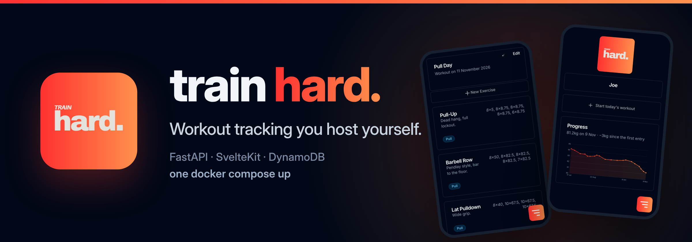

<br>

[](https://github.com/joecrockett5/train-hard/actions/workflows/ci.yml)
[](https://github.com/joecrockett5/train-hard/releases)
[](LICENSE)
[](https://github.com/joecrockett5?tab=packages&repo_name=train-hard)

[](backend/pyproject.toml)
[](backend/requirements.txt)
[](frontend/package.json)
[](frontend/package.json)
[](frontend/tailwind.config.js)
[](docker-compose.yml)

**A workout tracker you run yourself.** FastAPI backend, SvelteKit frontend,
DynamoDB for storage — all of it local, in Docker. No AWS account, no sign-up,
no subscription, no one else holding your training history.

[Quick start](#quick-start) · [Features](#features) · [Screenshots](#screenshots) · [Deployment](docs/deployment.md) · [Configuration](docs/configuration.md) · [Architecture](docs/architecture.md)

</div>

---

## Quick start

```bash
docker compose up --build
```

Then open **http://localhost:3000**, create a profile, and you're in.

No other steps: tables are created automatically, and there is no `.env` to
write — every setting has a working default. Copy `.env.example` to `.env`
only if you want to change something (ports, mainly).

| URL | What |
| --- | --- |
| http://localhost:3000 | The app |
| http://localhost:8000/docs | Backend API docs (Swagger), loopback only |
| http://localhost:8000/health | Backend health + DynamoDB reachability, loopback only |
| http://localhost:8001 | DynamoDB Local, loopback only |

**Prerequisites:** Docker Desktop, or any Docker Engine with Compose v2 —
nothing else. No Python, Node or AWS CLI on the host. Roughly 2 GB free for
images.

Prefer the published images to a local build? One more file, and nothing to
configure:

```bash
docker compose -f docker-compose.yml -f docker-compose.ghcr.yml up -d
```

## Logging a session

<div align="center">
  
</div>

Start the day's workout, pull in a template, open an exercise and log a set —
the whole loop, on a phone, in about fifteen seconds. Every exercise shows what
you did last time it came round, and the weight field arrives pre-filled with
it, because the question at the bar is almost always "what did I do last
week?".

## Features

- **Profiles, not accounts.** No passwords and no user pool. A profile is a
  name; picking one scopes every workout, exercise and set to it. Switching is
  one tap in the nav sheet.
- **Workouts from templates.** Save a session's shape once — Push Day, Legs —
  and import it into a new workout instead of rebuilding it each week.
- **Sets that remember.** Working and warm-up sets per exercise, with the
  previous session's numbers shown beside the input and used to pre-fill it.
- **Tags that filter.** Tag exercises by workout type and filter the library by
  any of them. Colours are assigned from a fixed palette, so a profile's tags
  come out distinct without anyone choosing.
- **Cardio too.** An exercise is `reps` or `time`; a timed one logs durations
  in minutes instead of reps at a weight. Same list, measured differently.
- **Body weight, graphed.** A date, a reading and optional notes, drawn as
  hand-written SVG — no charting library — with points spaced by elapsed days,
  so a gap in the record looks like a gap.
- **Progress photos.** Attach a photo to a weigh-in and put any two of them
  side by side, with the weights and the interval between them.
- **kg or lbs, losslessly.** Everything is stored in kilograms; the unit is a
  display preference, so a round trip through the other unit returns the
  number you started with.
- **Dark mode, server-rendered.** A per-profile preference that follows whoever
  is signed in, applied before the response is sent — no white flash on load.
- **Installs to a phone.** A web manifest and a service worker, so it opens
  from the home screen without browser chrome and the interface survives a bad
  connection.
- **Yours.** One `docker compose up`, one named volume, no telemetry and no
  network calls off the machine.

## Screenshots

<div align="center">

| Home | Workout | Exercises |
| :---: | :---: | :---: |
| 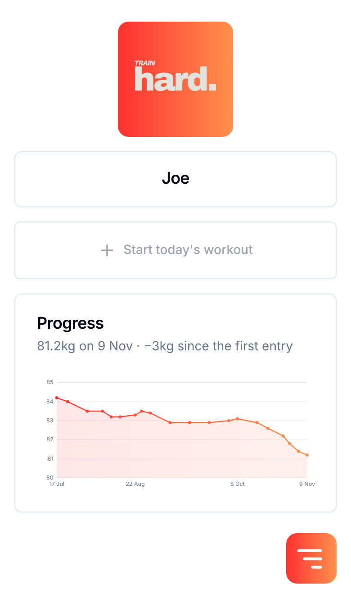 | 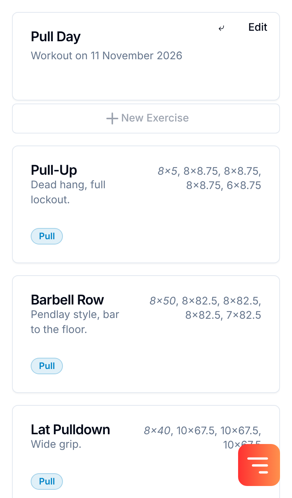 | 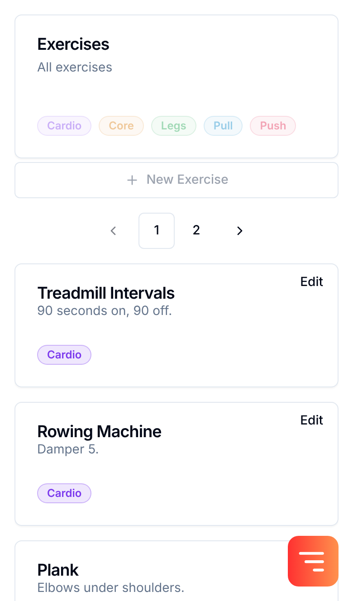 |
| **Body weight** | **Compare** | **Templates** |
| 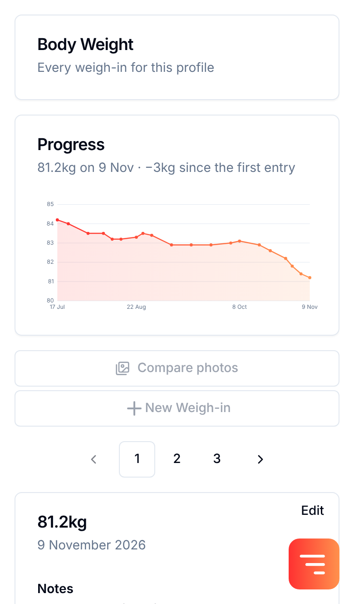 | 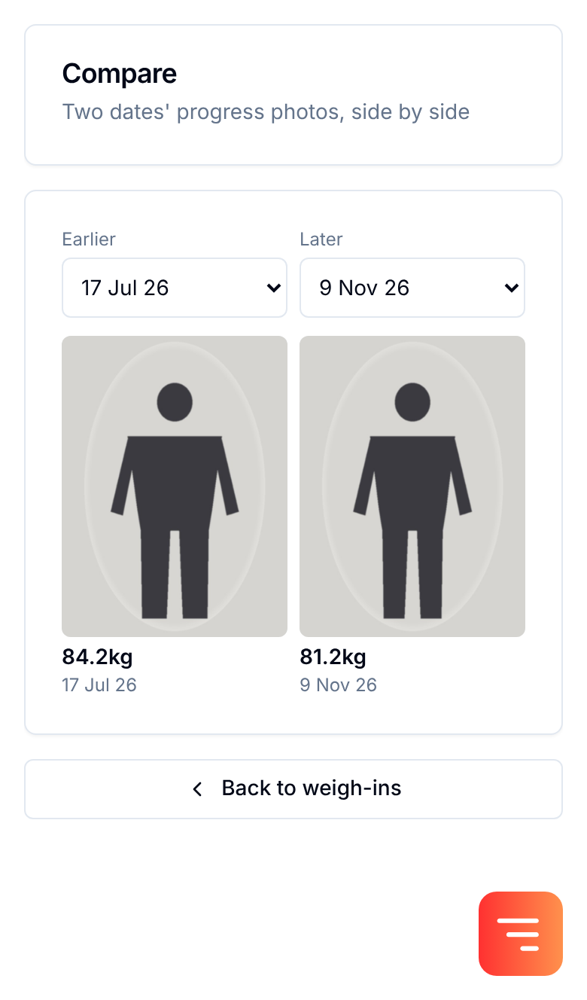 | 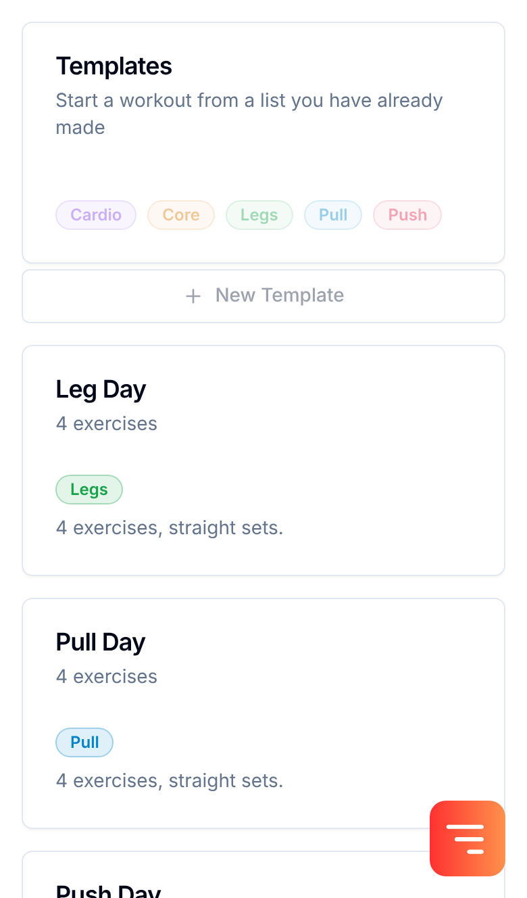 |

</div>

<details>
<summary><b>The same screens in dark mode</b></summary>

<div align="center">

| Home | Workout | Exercises |
| :---: | :---: | :---: |
| 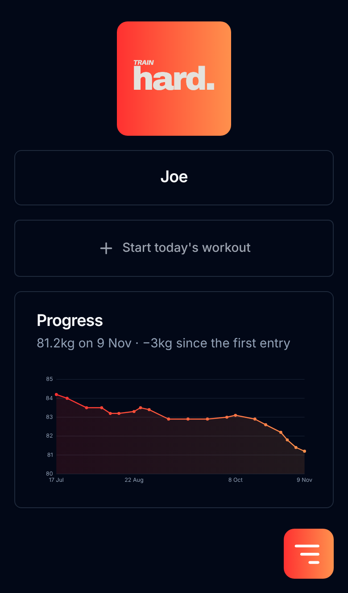 | 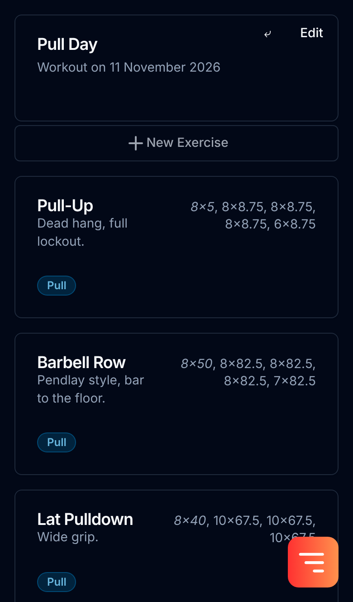 | 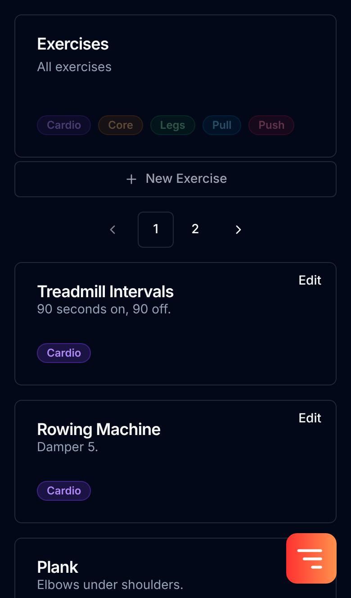 |
| **Body weight** | **Compare** | **Templates** |
| 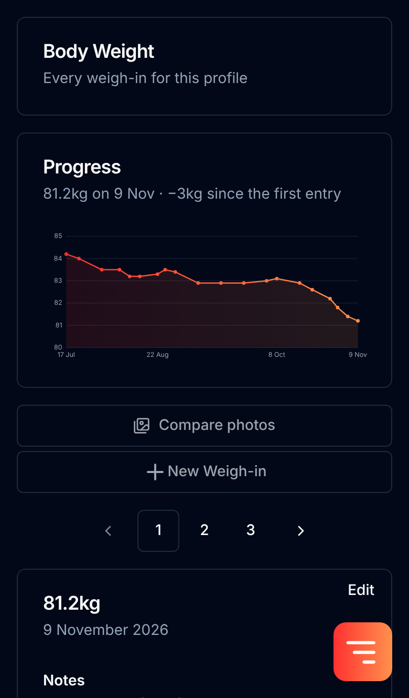 | 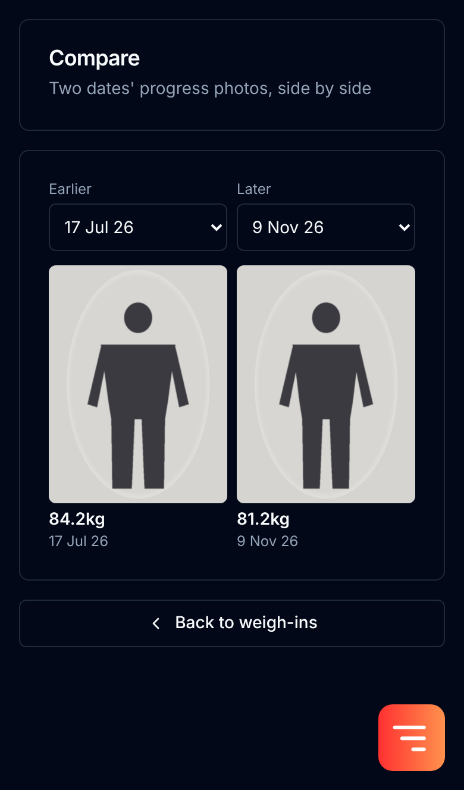 | 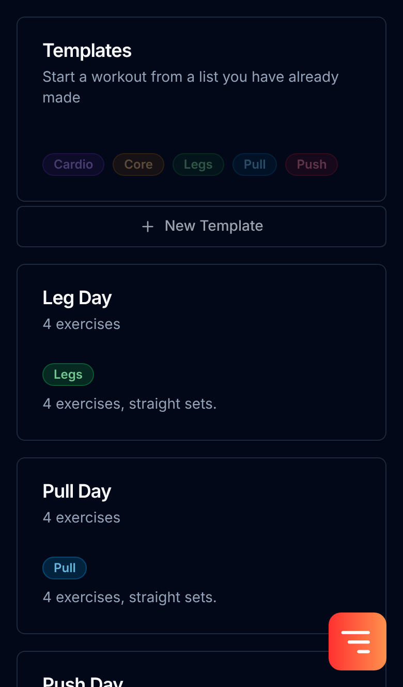 |

</div>

</details>

<details>
<summary><b>Calendar, navigation and profiles</b></summary>

<div align="center">

| Workouts by date | Nav sheet | Profiles |
| :---: | :---: | :---: |
| 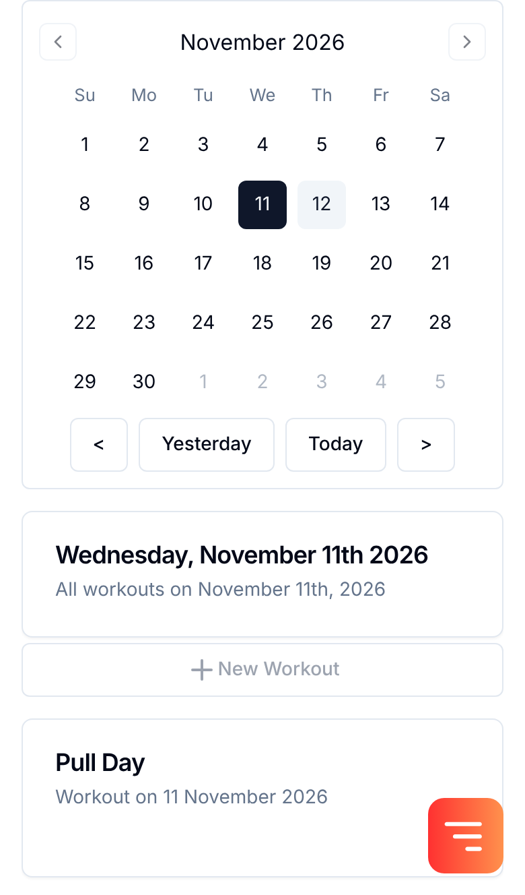 | 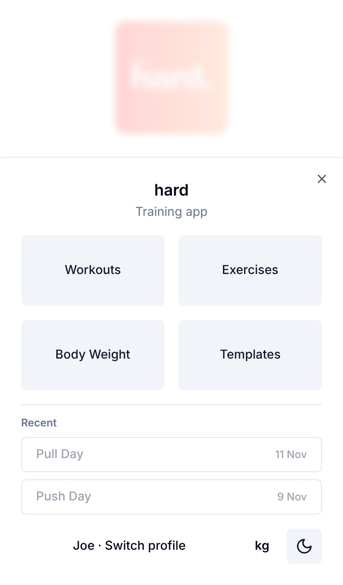 | 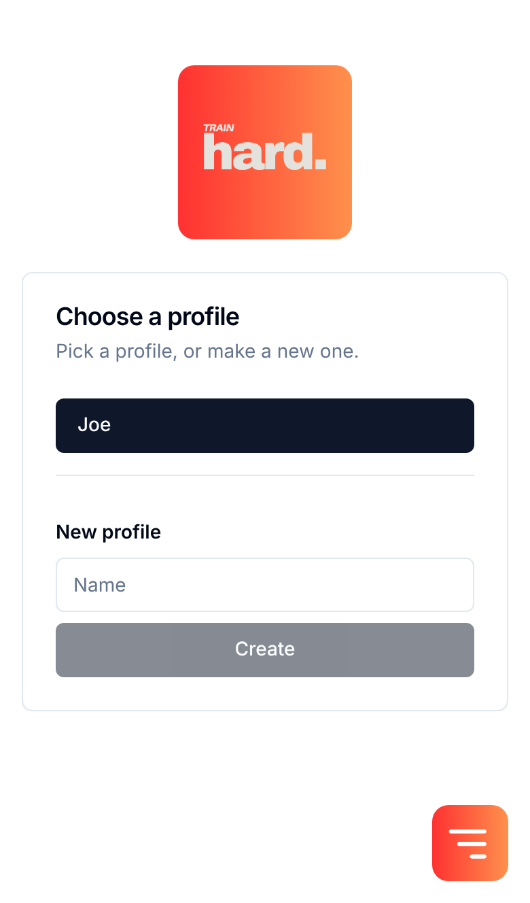 |

</div>

</details>

## How it works

```
browser ──▶ frontend :3000 ──▶ backend :8000 ──▶ dynamodb :8000
            (SvelteKit)        (FastAPI)         (DynamoDB Local)
             │                                     │
             └─ /api/* server routes                └─ /data on a named volume
                proxy and rename fields
```

The browser only ever talks to the SvelteKit server. Its `/api/*` routes are
the only thing that calls the backend, so there is no browser-facing backend
URL and no CORS configuration — and none is needed, because no cross-origin
request is ever made. Storage is a single DynamoDB table whose partition key
packs the owning profile and the object type together, which is why selecting a
profile is all it takes to scope the data.

[The architecture notes](docs/architecture.md) go through the table layout and
the reasoning behind each feature that has any.

```
backend/        FastAPI app (Python 3.11)
frontend/       SvelteKit app (adapter-node)
docs/           Deployment, configuration, architecture, troubleshooting
scripts/        Table creation and seeding
seed-data/      Drop JSON dumps here (gitignored)
infra-legacy/   The old AWS deployment config, kept for reference
```

## Documentation

| | |
| --- | --- |
| [Deployment](docs/deployment.md) | Running it on a server behind a proxy, published images, updates, backups, phone install |
| [Configuration](docs/configuration.md) | Every environment variable, the compose files, ports, and the origin in detail |
| [Architecture](docs/architecture.md) | How the services fit together, the data model, and the design decisions |
| [Troubleshooting](docs/troubleshooting.md) | The failures that actually happen, and what they mean |
| [Contributing](.github/CONTRIBUTING.md) | Dev mode, the test suites, and how a change gets in |
| [Frontend notes](frontend/README.md) | Working on the SvelteKit app on its own |

## Branches

| Branch | UI language |
| --- | --- |
| `main` | English |
| `japanese` | Japanese (日本語) |

They are identical apart from the interface strings and date formatting.
`japanese` is the original UI the app was written with, preserved so it can be
picked up again; `main` is the English translation of it. Any change that is
not a user-facing string should land on both.

The images never share a tag, so an update cannot quietly change the language:
`main` owns `latest`, `japanese` has its own branch tag, and a release cut from
it is suffixed `-ja`. See [published images](docs/deployment.md#published-images).

## Roadmap

Nothing here is promised; it is what would come next.

- [ ] Search on the workouts and exercises pages
- [ ] Offline logging — the service worker caches the interface but not `/api`,
      so logging a set still needs the backend reachable. A real sync queue is
      the missing piece.
- [ ] Per-exercise progress charts, reusing the body-weight chart
- [ ] Rest timer between sets
- [ ] Export a profile's data without reaching for the DynamoDB volume

## Contributing

Issues and pull requests are welcome — see
[CONTRIBUTING.md](.github/CONTRIBUTING.md) for dev mode, the test suites, and
the one rule that matters (changes that are not user-facing strings land on
both branches). Participation is governed by the
[Code of Conduct](.github/CODE_OF_CONDUCT.md).

## Licence

[MIT](LICENSE) © Joe Crockett
